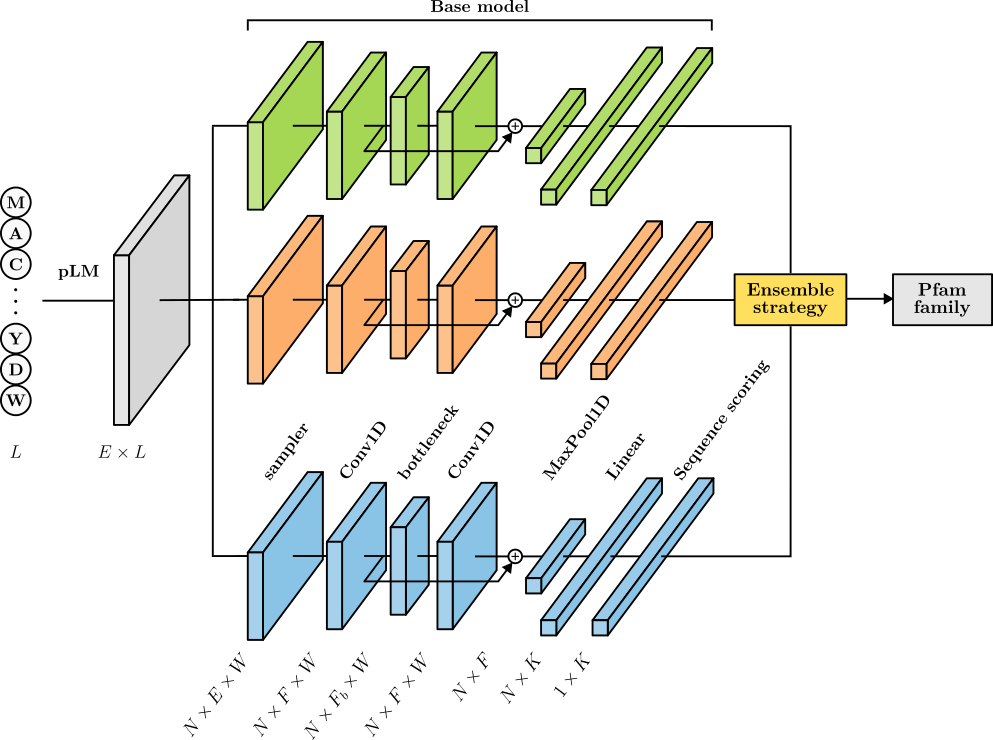

# ET-Pfam-R: Ensemble Transfer Learning for Protein Family Prediction

This repository contains the data and source code for the manuscript *ET-Pfam: Ensemble transfer learning for protein family prediction*, by S. Escudero, S. A. Duarte, R. Vitale, E. Fenoy, L.A. Bugnon, D.H. Milone and G. Stegmayer, 2025. Research Institute for Signals, Systems and Computational Intelligence, [sinc(i)](https://sinc.unl.edu.ar/).



**ET-Pfam-R** extends the baseline deep learning ensemble with:
- **Modular pLM Abstraction Layer**: Native support for **ESM-2** (e.g. `facebook/esm2_t33_650M_UR50D`) alongside the baseline **ESM-1b** model, with strict `[1280, L]` shape guarantees.
- **Conformal Prediction**: Statistically guaranteed prediction sets at user-defined coverage (e.g., 90% marginal coverage with $\alpha = 0.10$).
- **Out-of-Distribution (OOD) Detection**: Random Neighbor Score (RNS) to flag twilight-zone and novel protein sequences.
- **FAISS Retrieval-Augmented Homology**: Top-5 nearest neighbor reference entries with cosine similarity metrics.
- **Sequence Explainability**: Gradient saliency (Input $\times$ Gradient, Integrated Gradients) and attention extraction to map functional residues and conserved core motifs.
- **Unified Pipeline (`predict_et_pfam_r.py`)**: End-to-end FASTA-to-report pipeline exporting structured JSON and CSV summaries.

---

## Quickstart: End-to-End Prediction in 1 Command

Once your environment is set up, run the unified pipeline on any FASTA file:

```bash
python3 predict_et_pfam_r.py -f data/sample_query.fasta -o report.json --format both --alpha 0.10
```

This generates:
1. `report.json`: Full detailed report with per-residue attribution scores, key functional residues, and FAISS matches.
2. `report.csv`: Tabular overview for high-throughput screening.

---

## 1. Environment Setup

Clone the repository and navigate into the project directory:

```bash
git clone https://github.com/sinc-lab/ET-Pfam
cd ET-Pfam
```

Create and activate a Python 3.11 virtual environment (using conda or venv):

```bash
conda create -n ET-Pfam python=3.11
conda activate ET-Pfam
```

Install the required dependencies:

```bash
pip install -r requirements.txt
```

---

## 2. Modular pLM Embedding Generation (`src/plm/`)

The repository provides a modular pLM abstraction layer and the CLI tool [`extract_embeddings.py`](extract_embeddings.py) to extract per-residue sequence embeddings from protein FASTA files. Both ESM-2 and the baseline ESM-1b model are natively supported with automatic shape formatting to `[1280, L]`:

```bash
# Extract embeddings with ESM-2 (650M, 1280-dim - ET-Pfam default):
python3 extract_embeddings.py -f data/sample_query.fasta -m esm2

# Extract embeddings with the baseline ESM-1b model:
python3 extract_embeddings.py -f data/sample_query.fasta -m baseline

# Custom batch size, output folder, and device:
python3 extract_embeddings.py -f data/sample_query.fasta -m esm2 -o data/embeddings/ -b 16 -d cuda

# List all registered pLM models and aliases:
python3 extract_embeddings.py --list_models
```

Extracted embeddings are automatically formatted to `[1280, L]` and saved as `<PID>.pk` files compatible with all downstream base models and ensemble classifiers.

---

## 3. Unified Inference Pipeline (`predict_et_pfam_r.py`)

The CLI script [`predict_et_pfam_r.py`](predict_et_pfam_r.py) orchestrates the entire ET-Pfam-R pipeline from raw FASTA input:

```bash
python3 predict_et_pfam_r.py \
    -f data/sample_query.fasta \
    -m models/mini/ \
    -o predictions_report \
    --format both \
    --alpha 0.10 \
    --top_k_homology 5 \
    --explain_method input_x_grad
```

### Generated Report Fields (JSON & CSV):
1. **Input Sequence Header** (`sequence_header`)
2. **Top Predicted Pfam Family** (`top_predicted_pfam`)
3. **Conformal Prediction Set** (`conformal_prediction_set` at 90% coverage)
4. **Calibrated Confidence Score & OOD Status** (`calibrated_confidence`, `ood_status`, `rns_score`)
5. **Top-5 Retrieved FAISS Homology Matches** (`faiss_homology_matches` with cosine similarity)
6. **Per-residue Attribution Map** (`per_residue_attribution_map`, `key_functional_residues`, `conserved_motifs`)

---

## 4. Uncertainty Calibration & OOD Detection (`uncertainty_calibration.py`)

The [`uncertainty_calibration.py`](uncertainty_calibration.py) module provides distribution-free Conformal Prediction and Out-of-Distribution (OOD) detection:

### 4.1 Conformal Prediction Wrapper

Constructs prediction sets with guaranteed marginal coverage ($\mathbb{P}(Y \in C(X)) \ge 1 - \alpha$):

```python
from uncertainty_calibration import ConformalPredictionWrapper

# 1. Initialize wrapper with Pfam categories and scoring method ('lac' or 'aps')
cp = ConformalPredictionWrapper(categories=categories, method="lac")

# 2. Calibrate on the dev partition predictions and ground truth labels
cp.calibrate(dev_outputs, dev_labels)

# 3. Produce conformal prediction sets on test predictions at alpha = 0.10 (90% coverage)
mask, prediction_sets = cp.predict_set(test_outputs, alpha=0.10)

# 4. Evaluate coverage and efficiency (set size) metrics
metrics = cp.evaluate_coverage(test_outputs, test_labels, alpha=0.10)
print(f"Empirical Coverage: {metrics['empirical_coverage']:.2%}")
print(f"Average Set Size  : {metrics['avg_set_size']:.2f}")
```

### 4.2 Random Neighbor Score (RNS) for OOD Detection

Flags novel or twilight-zone sequences based on distance to the in-distribution reference manifold:

```python
from uncertainty_calibration import compute_random_neighbor_score, OODDetector

# Option A: Compute RNS directly
rns_scores = compute_random_neighbor_score(
    query_embeddings=test_embeddings,
    reference_embeddings=dev_embeddings,
    k=10,
    metric="cosine"
)

# Option B: Calibrate an OOD detector at a target False Positive Rate (e.g. FPR = 0.05)
ood_detector = OODDetector(k=10, metric="cosine", target_fpr=0.05)
ood_detector.fit(reference_embeddings=dev_embeddings)
is_ood, scores = ood_detector.predict(test_embeddings)
```

---

## 5. Retrieval-Augmented Homology Evidence (`retrieval_evidence.py`)

The [`retrieval_evidence.py`](retrieval_evidence.py) module provides fast vector similarity indexing using FAISS over Pfam reference embeddings:

```python
from retrieval_evidence import (
    PfamRetrievalIndex,
    search_top_k_neighbors,
    build_index_from_directory,
)

# 1. Build an index from reference embeddings and metadata
index = PfamRetrievalIndex(dimension=1280)
index.add_references(
    embeddings=reference_embeddings, # [N, 1280] or list of [1280, L]
    headers=sequence_headers,        # e.g. ['E3QE54_COLGM', ...]
    pfam_ids=assigned_pfam_ids,      # e.g. ['PF12767', ...]
)

# 2. Query with a sequence embedding to retrieve top-5 most similar reference entries
query_embedding = test_embeddings[0] # [1280] or 2D [1280, L]
top5_results = search_top_k_neighbors(query_embedding, index, top_k=5)

for hit in top5_results:
    print(f"Rank {hit['rank']}: {hit['header']} | Family: {hit['pfam_id']} | Cosine Similarity: {hit['cosine_similarity']:.4f}")
```

---

## 6. Sequence Explainability & Domain Attribution (`sequence_explainability.py`)

The [`sequence_explainability.py`](sequence_explainability.py) module provides gradient-based saliency mapping (Input $\times$ Gradient, Integrated Gradients) to calculate per-residue attribution scores and map them onto predicted Pfam domains:

```python
from sequence_explainability import explain_prediction

# Generate domain attribution report using Integrated Gradients or Input x Grad
report = explain_prediction(
    model=base_model,                     # Trained ET-Pfam BaseModel
    embedding=protein_embedding,          # Per-residue tensor [1280, L]
    sequence=amino_acid_sequence,         # Optional amino acid string
    domain_interval=(start_pos, end_pos), # 1-based Pfam domain boundaries
    categories=categories,                # Pfam family list
    method="integrated_gradients",        # 'input_x_grad', 'integrated_gradients', 'vanilla_grad'
    top_k_residues=10                     # Top key residues to highlight
)

# Inspect key functional residues and conserved motifs
print(report.summary())
print(f"Domain Enrichment: {report.domain_enrichment_ratio:.2f}x")
for res in report.key_residues[:5]:
    print(f"Position {res.position} ({res.amino_acid}): Score = {res.attribution_score:.4f} ({res.percentile:.1f}%ile)")
```

---

## 7. Test Pre-Trained ET-Pfam Ensembles (Mini Dataset)

To reproduce the ensemble evaluation from the manuscript on the *mini dataset*:

### 7.1 Download test embeddings
```bash
mkdir -vp data/embeddings/
gdown 1B0T5C8XiVheYTw6IEFAf3LOFsupzPLVs --output data/mini_test.tar.gz
tar -xzf data/mini_test.tar.gz -C data/embeddings/
```

### 7.2 Download trained base models and ensemble weights
```bash
mkdir -vp models/
gdown 1SFOHaZy7NtXohyqdT3-LIvH5sC67WyMy --output models/mini.tar.gz
tar -xzf models/mini.tar.gz -C models/
```

### 7.3 Run ensemble evaluation
```bash
python3 test_ensemble.py -v all -m models/mini/
cat results/mini/ensemble_metrics.csv
```

---

## 8. Train Base Models and Ensembles

### 8.1 Train an Individual Base Model
Download training embeddings:
```bash
gdown 12-NZPjjeiAKqp4A8gQ9KfIpSzuBawdMp --output data/mini_train.tar.gz
tar -xzf data/mini_train.tar.gz -C data/embeddings/
```
Run training:
```bash
python3 train_basemodel.py -o models/mini/<model_name>
```
To evaluate the single model:
```bash
python3 test_basemodel.py -o models/mini/<model_name>
```

### 8.2 Train Ensemble Weights
Download dev embeddings:
```bash
gdown 15pHIO7J2awgwkgHR5d4MhK2mt4JC1j54 --output data/mini_dev.tar.gz
tar -xzf data/mini_dev.tar.gz -C data/embeddings/
```
Fit ensemble weights:
```bash
python3 train_ensemble.py -v all -m models/mini/
```

---

## 9. Reproduce Results with Full Pfam Dataset

### 9.1 Download Full Dataset & Models
```bash
gdown --folder 18bD2q-iL2MZE2ddH_-jRp_VDZXoZG8QP --output data/
gdown 1HFsSCg-z7NqKwdMfxgj8y1-Ux1X7zJnJ --output data/full_test.tar.gz
tar -xzf data/full_test.tar.gz -C data/embeddings/
gdown 179qTQ-1akdUIkdfjcrxo5X1OOLvEboMl --output models/full.tar.gz
tar -xzf models/full.tar.gz -C models/
```

Update `dataset` field in `config/base.json`:
```bash
sed -i 's/mini/full/g' config/base.json
```

Run full evaluation:
```bash
python3 test_ensemble.py -v all -m models/full/
cat results/full/ensemble_metrics.csv
```

---

## 10. Running the Master Test Suite

The repository includes a comprehensive test runner executing 5 modular test suites covering all functionalities:

```bash
python3 run_all_tests.py
```

| Test Suite | File | Description |
|---|---|---|
| **pLM Abstraction** | `tests/test_plm_abstraction.py` | ESM-2/1b loading, tokenization, and `[1280, L]` shape verification |
| **Uncertainty & OOD** | `tests/test_uncertainty_calibration.py` | Conformal marginal coverage (90%) and RNS distance scoring |
| **FAISS Retrieval** | `tests/test_retrieval_evidence.py` | FAISS index, top-5 nearest neighbors, and metadata persistence |
| **Explainability** | `tests/test_sequence_explainability.py` | Saliency maps (Input x Grad, IG), domain mapping, and motifs |
| **Unified CLI** | `tests/test_predict_et_pfam_r.py` | End-to-end integration and schema validation of `predict_et_pfam_r.py` |

---

## 11. Project Directory Structure

```text
ET-Pfam-R/
├── config/
│   ├── base.json                   # Hyperparameters (window_len, lr, batch_size, step, plm)
│   └── env.json                    # Environment settings (device, nworkers, emb_path)
├── data/
│   ├── mini/                       # Mini dataset CSVs and categories.txt
│   ├── full/                       # Full dataset CSVs and categories.txt
│   ├── embeddings/                 # Directory containing per-residue <PID>.pk tensors
│   └── sample_query.fasta          # Sample query FASTA
├── src/
│   ├── basemodel.py                # 1D Dilated Residual CNN
│   ├── ensemble.py                 # Multi-model ensemble with 4 voting strategies
│   ├── dataset.py                  # PyTorch dataset loader with soft labels
│   ├── train.py                    # Training loop with early stopping
│   ├── centered_window_test.py     # Centered window evaluation (CwS)
│   ├── sliding_window_test.py      # Sliding window evaluation (SwM, SwA, SwC)
│   ├── utils.py                    # Config loader, prediction routine, ResultsTable
│   ├── plm/                        # Modular pLM subsystem (ESM-2, ESM-1b)
│   ├── uncertainty_calibration.py  # Conformal prediction & RNS OOD detector
│   ├── retrieval_evidence.py       # FAISS vector similarity index & homology retrieval
│   └── sequence_explainability.py  # Saliency maps (Input x Grad, IG) & domain attribution
├── tests/                          # Master test suite directory
├── extract_embeddings.py           # CLI tool: Batch embedding generation
├── predict_et_pfam_r.py            # Unified end-to-end inference CLI script
├── run_all_tests.py                # Master test runner
├── train_basemodel.py              # CLI tool: Train single base model
├── test_basemodel.py               # CLI tool: Test single base model
├── train_ensemble.py               # CLI tool: Fit ensemble weights
├── test_ensemble.py                # CLI tool: Test ensemble models
├── requirements.txt                # Python package dependencies
└── README.md                       # Documentation
```

---

## 12. Citation

If you use ET-Pfam or ET-Pfam-R in your research, please cite:

```bibtex
@article{escudero2025etpfam,
  title={ET-Pfam: Ensemble transfer learning for protein family prediction},
  author={Escudero, S. and Duarte, S. A. and Vitale, R. and Fenoy, E. and Bugnon, L. A. and Milone, D. H. and Stegmayer, G.},
  journal={Research Institute for Signals, Systems and Computational Intelligence, sinc(i)},
  year={2025}
}
```
